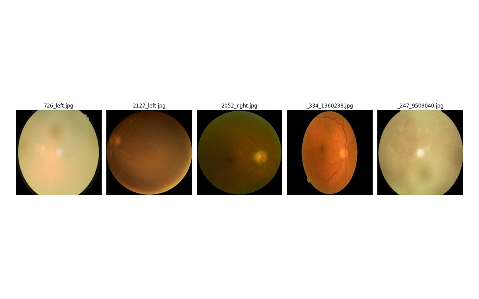

# Eye disease screening

A small Flask app that takes a retinal (fundus) photograph, uploaded or fetched from a link, and returns the probability of each of four classes: cataract, diabetic retinopathy, glaucoma, or a normal eye.



## What is in this repository

| File | Purpose |
| --- | --- |
| `train_cnn.ipynb` | Data loading, the CNN, training curves and the classification report |
| `app.py` | Flask app: upload or paste an image link, get all four classes ranked by probability |
| `requirements.txt` | Python dependencies |

The trained weights and the image dataset are not stored here. Train the model with the notebook, or point the app at your own `.h5` file.

## Model

A plain Keras CNN on 256 x 256 RGB images: three convolution and max-pooling blocks (32, 64, 128 filters), a 128-unit dense layer, and a 4-way softmax. Trained with Adam and categorical cross-entropy, with early stopping on validation loss.

The notebook also contains an earlier, deeper six-convolution variant with filter and feature-map visualisations.

## Results

Data: 4,217 labelled retinal images in four classes, split 80/20 into 3,374 training and 843 validation images.

| Measure | Value |
| --- | --- |
| Validation accuracy (held-out 843 images) | 84.7% best, 83.2% at the final epoch |
| Accuracy over all 4,217 images | 89.78% |

The 89.78% figure is measured over the whole dataset, which includes the training images, so the validation accuracy is the fairer estimate of how the model does on unseen images.

Per-class results over all 4,217 images:

| Class | Precision | Recall | F1 | Images |
| --- | --- | --- | --- | --- |
| Cataract | 0.91 | 0.83 | 0.87 | 1,038 |
| Diabetic retinopathy | 1.00 | 1.00 | 1.00 | 1,098 |
| Glaucoma | 0.84 | 0.84 | 0.84 | 1,007 |
| Normal | 0.84 | 0.92 | 0.87 | 1,074 |

Diabetic retinopathy is separated almost perfectly. Most errors are between glaucoma, cataract and normal eyes.

## Run it

```bash
python -m venv .venv
.venv\Scripts\activate          # Windows; use `source .venv/bin/activate` on Linux or macOS
pip install -r requirements.txt
```

1. Put the images in `dataset/` with one folder per class (`cataract`, `diabetic_retinopathy`, `glaucoma`, `normal`), set the dataset path at the top of `train_cnn.ipynb`, and run it. It saves `eye_disease_model.h5`.
2. Move the model to `models/Eyesprediction.h5`, or set `EYE_MODEL_PATH` to wherever it is.
3. Start the app:

```bash
python app.py
```

Then open http://127.0.0.1:5000, upload an image or paste a link to one, and read the ranked probabilities.

## Limits

This is a learning and demonstration project, not a medical device. It was trained on one public dataset, has not been validated clinically, and must not be used to diagnose anyone.

## Author

Muhammad Umer Khan, [Neurals Solutions](https://neuralssolutions.com)

## License

MIT. See [LICENSE](LICENSE).
